# Parte 3. Preparación del entorno Java

*Requisitos EDD-01 y EDD-02.*

## 3.1 Instalación del JDK

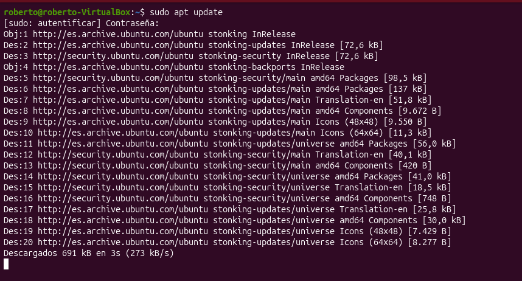

**Figura 1.** Actualización de la lista de paquetes antes de instalar.

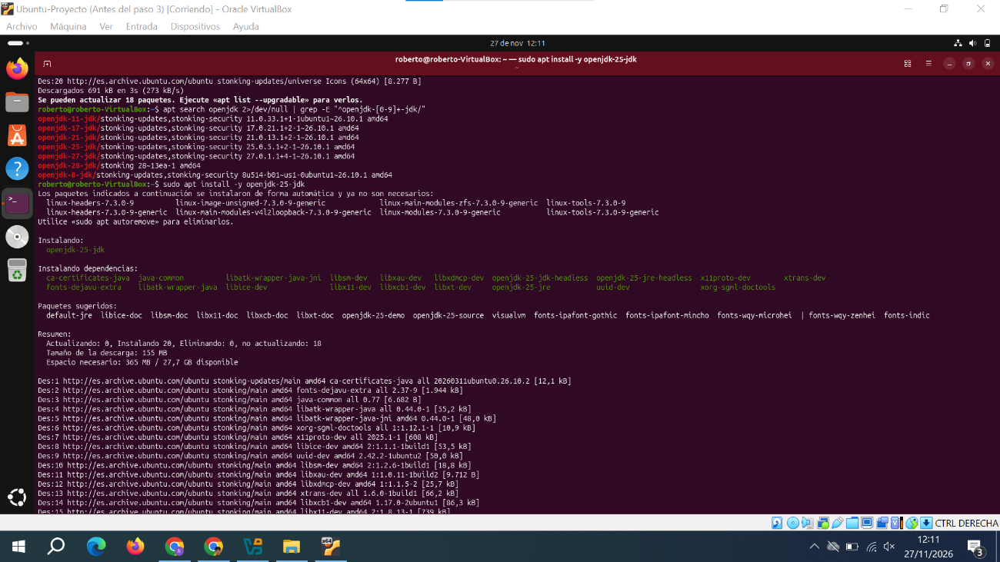

**Figura 2.** Versiones de OpenJDK disponibles e instalación de la 25 (LTS).

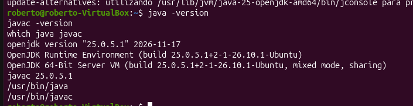

**Figura 3.** OpenJDK 25 instalado: máquina virtual (java) y compilador (javac).

## 3.2 Instalación de Visual Studio Code

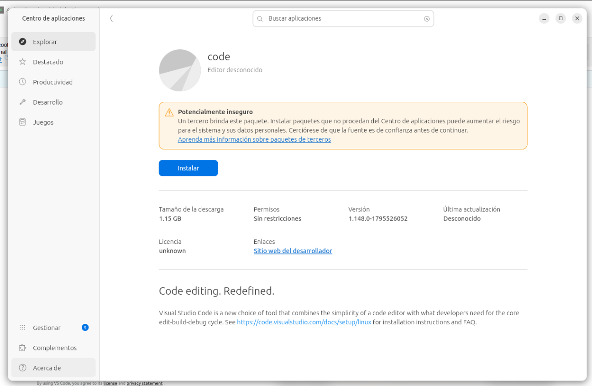

**Figura 4.** Aviso del Centro de aplicaciones por ser un paquete de terceros.

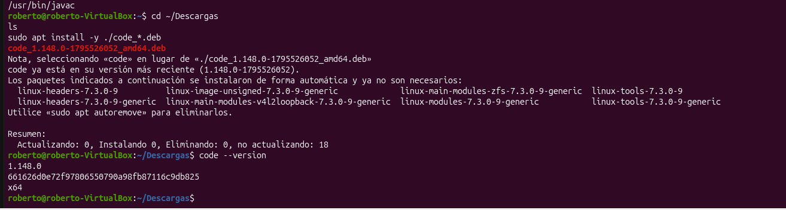

**Figura 5.** Visual Studio Code 1.148.0 instalado.

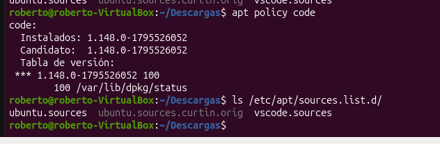

**Figura 6.** Repositorio de Microsoft añadido, aún sin leer por apt.

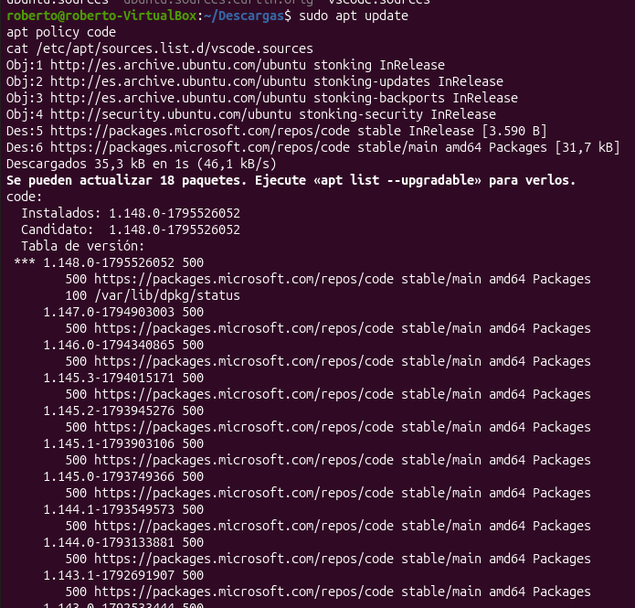

**Figura 7.** Versiones de VS Code en el repositorio de Microsoft.

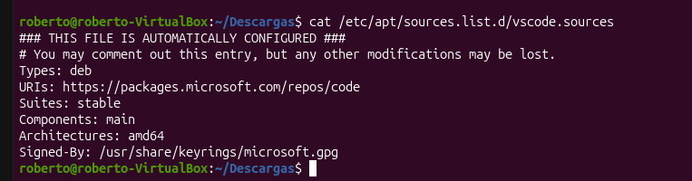

**Figura 8.** Archivo vscode.sources con la clave de firma.

## 3.3 Primer arranque

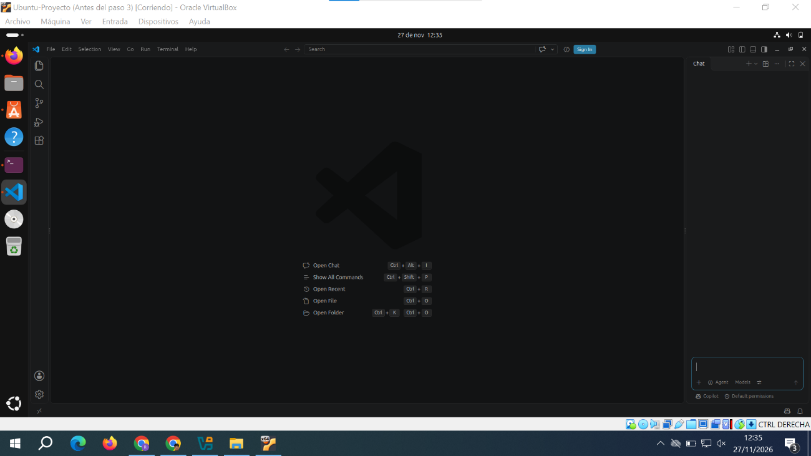

**Figura 9.** Primer arranque de Visual Studio Code.

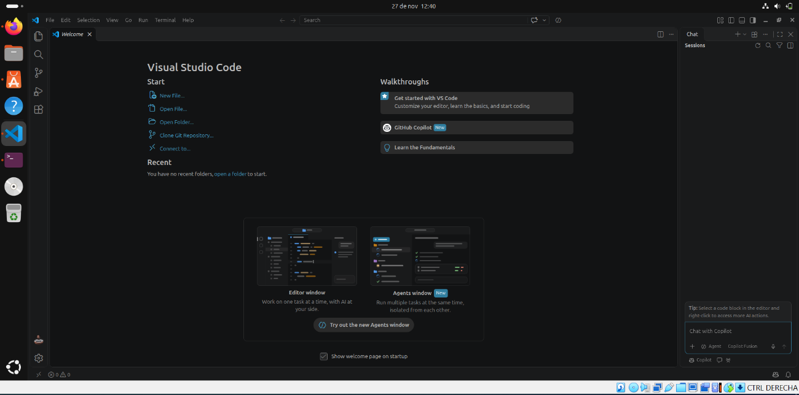

**Figura 10.** Página de bienvenida de Visual Studio Code.

## 3.4 Actualización del sistema y Git

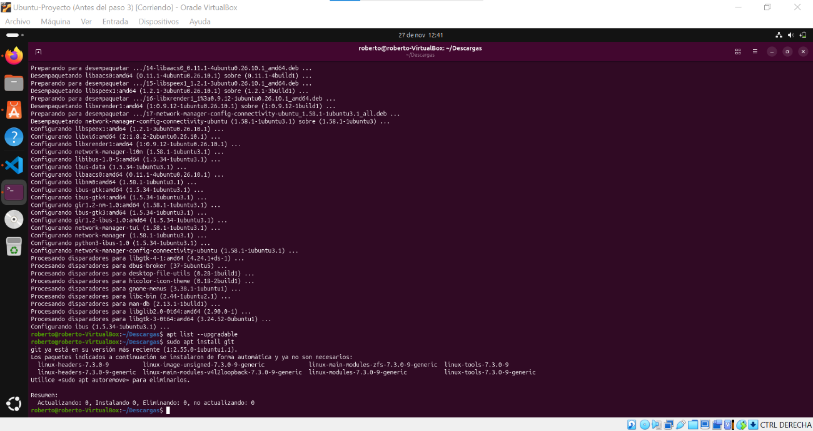

**Figura 11.** Sistema actualizado y Git instalado (2.55.0).

## 3.5 Extensiones para Java

Se usa la extensión Java de Oracle (editar, compilar, depurar y probar) junto con Maven for Java.

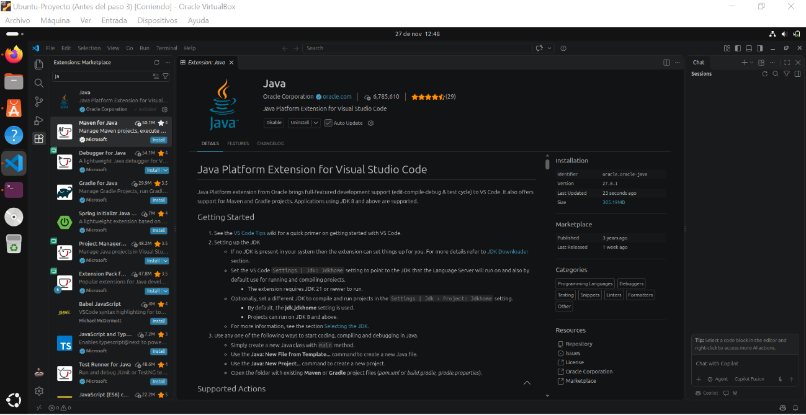

**Figura 12.** Extensión Java de Oracle instalada.

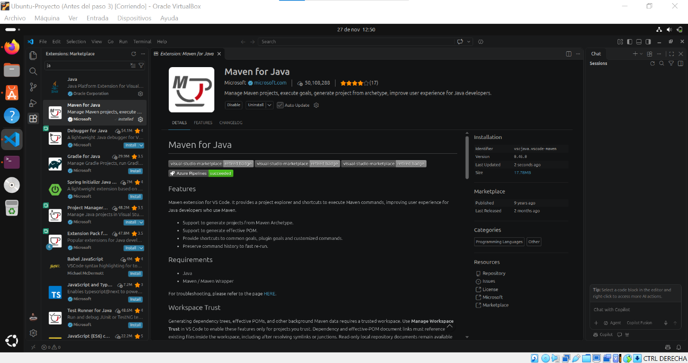

**Figura 13.** Extensión Maven for Java instalada.

## 3.6 Versión de Java y clave SSH

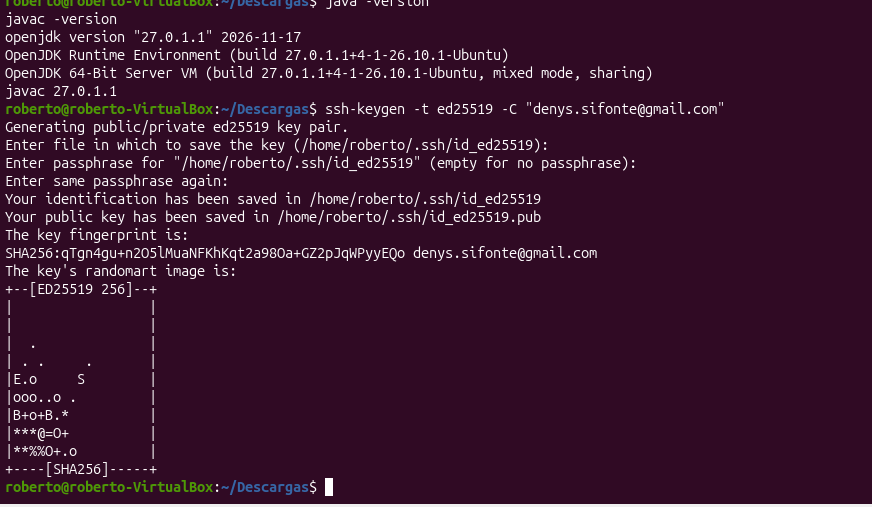

**Figura 14.** Java 27 en uso y generación de la clave SSH.
